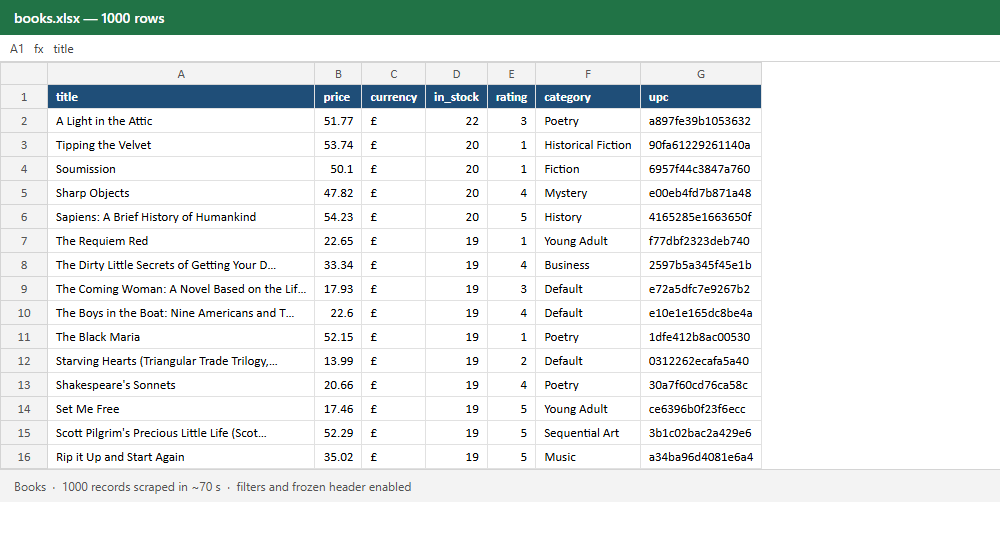

# books-scraper

A production-style web scraper that collects the full catalogue of [books.toscrape.com](https://books.toscrape.com) (a sandbox site built for scraping practice) and exports it to **Excel, CSV or JSON**.

It scrapes all 1,000 books in about a minute and is structured the way client scrapers should be: a separate HTTP layer, pure parsing functions, unit tests, and a clean command-line interface.



## What it collects

| Field | Example |
|---|---|
| title | A Light in the Attic |
| price / currency | 51.77 / £ |
| in_stock | 22 |
| rating | 3 (1–5) |
| category | Poetry |
| upc | a897fe39b1053632 |
| description | full text |
| image_url, url | absolute links |

## Features

- **Pagination**: follows "next" links until the last page, or stops after `--max-pages`.
- **Parallel downloads** with a shared rate limit, so the target site is never flooded.
- **Retries with backoff** on timeouts and 429/5xx responses.
- **Fault tolerance**: one broken page is logged and skipped; the run continues.
- **Excel output** ready for a non-technical client: bold header, filters, frozen top row, sized columns.
- **CSV in UTF-8 with BOM**, so Excel opens non-English text correctly.
- **Stable output order** regardless of which download finishes first.

## Quick start

```bash
python -m venv .venv
.venv\Scripts\activate          # Windows
# source .venv/bin/activate     # macOS / Linux
pip install -r requirements.txt

python -m scraper --out output/books.xlsx
```

More examples:

```bash
# First two pages only, as CSV
python -m scraper --max-pages 2 --out output/books.csv

# One category, as JSON
python -m scraper --start-url https://books.toscrape.com/catalogue/category/books/poetry_23/index.html --out output/poetry.json

# Gentler on the server
python -m scraper --workers 2 --delay 1.0
```

## Project structure

```
scraper/
  fetch.py    HTTP session: retries, timeouts, shared rate limit
  parse.py    HTML -> Book objects (pure functions, no network)
  export.py   CSV / JSON / formatted XLSX
  cli.py      argument parsing and orchestration
tests/
  test_parse.py
```

## Tests

```bash
pip install -r requirements-dev.txt
pytest
```

The parsers are tested against saved HTML, so tests run offline in under a second.

## Adapting it to another site

Only `parse.py` (selectors) and the start URL change. The fetching, retry, rate-limit and export layers are reused as-is.
